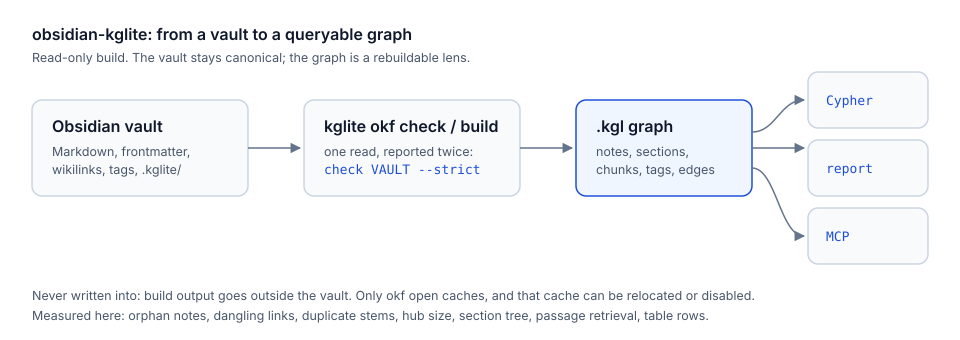

# obsidian-kglite

[中文](README.md) · English · kglite 0.21.2 / Obsidian 1.14.5 · last verified 2026-10-26

An agent skill that turns an Obsidian vault into a queryable [KGLite](https://kglite.readthedocs.io/)
knowledge graph — and then answers questions the vault cannot answer by eye.



- **Measure**: orphan notes, dangling links, duplicate stems, hub inflation, which section mentions
  what, which table row carries which fact.
- **Repair**: act on those measurements with evidence, then re-measure.
- **Serve**: expose the graph to another agent over MCP, with skills and parameterised recipes that
  live inside the vault.

The vault stays the source of truth. The graph is a rebuildable lens, and building it never writes into
the vault.

## Requirements

| Component | Version | Why |
| --- | --- | --- |
| Python | 3.10+ | the scripts and the API |
| kglite | 0.21.2+ | the graph engine, `okf` vault dialect, CLI |
| Obsidian | 1.14+ | only for the CLI-based repair path |

```bash
uv tool install kglite==0.21.2     # CLI
# or, in a project venv:
uv pip install kglite==0.21.2
```

## Install the skill

```bash
# npx skills (recommended)
npx skills add KRPCT/obsidian-kglite@obsidian-kglite -g -y

# Claude Code plugin marketplace
/plugin marketplace add KRPCT/obsidian-kglite
/plugin install obsidian-kglite@obsidian-kglite

# manual: Codex / any agent that reads a skills directory
git clone https://github.com/KRPCT/obsidian-kglite.git
cp -r obsidian-kglite/skills/obsidian-kglite ~/.agents/skills/
```

## Use it

```bash
mkdir -p .kglite-out
kglite okf check VAULT --strict
kglite okf build VAULT -o .kglite-out/vault.kgl
kglite query .kglite-out/vault.kgl "MATCH (n) WHERE n.file_path IS NOT NULL RETURN count(*) AS notes" --format json
kglite okf status VAULT --graph .kglite-out/vault.kgl
```

Or through the bundled wrapper, which refuses the three mistakes this workflow invites (missing output
directory, graph written inside the vault, two statements in one query):

```bash
python skills/obsidian-kglite/scripts/vault_graph.py build VAULT
python skills/obsidian-kglite/scripts/vault_report.py VAULT --out .kglite-out/health.md
```

## What is inside

```text
skills/obsidian-kglite/
  SKILL.md                     entry point: mental model, loop, failure modes, verification
  references/
    VAULT-FORMAT.md            the normative format, condensed with section numbers
    CYPHER-COOKBOOK.md         queries by question, each one executed
    ANNOTATIONS.md             the five in-note annotations and the queries that read them
    LINK-GRAPH.md              link-repair protocol: two-signal rule, anti-sprawl checks
    WRITEBACK.md               graph-to-vault: canvas, skipped index, sealed export, round-trip checks
    SERVING.md                 MCP server, .kglite/skills, .kglite/recipes, output budgets
    OBSIDIAN-CLI.md            inlined Obsidian CLI reference (upstream-synced)
    OBSIDIAN-MARKDOWN.md       inlined Obsidian markdown essentials (upstream-synced)
    SOURCES.md                 provenance, verified vs documented-only
  scripts/
    vault_graph.py             path-safe CLI wrapper
    vault_canvas.py            Graph.canvas / Mermaid view, zero graph impact
    vault_writeback.py         backlinks index (kg_skip) and sealed export
    vault_roundtrip.py         export/build/export proof with reconciliation
    vault_report.py            Markdown health report
    check_upstream.py          drift check for the inlined Obsidian material
    install_local.py           deploy this skill into a skills directory
  assets/
    vault.yaml                 starter .kglite/vault.yaml
    note-annotations.md        template showing all five annotations
    skill-for-vault.md         template for .kglite/skills/
  evals/evals.json             prompts the skill is expected to handle
```

## Graph → vault: the other half of the loop

A read-only graph answers half the question. The other half is getting the graph back into Obsidian
where a reader can see it — without poisoning the graph being measured. Three mechanisms, three blast
radii:

| Goal | Command | Writes | Next build |
| --- | --- | --- | --- |
| see the relationship graph in Obsidian | `scripts/vault_canvas.py VAULT` | `Graph.canvas` | unchanged (canvas is never parsed) |
| per-note inbound/outbound lists | `scripts/vault_writeback.py backlinks VAULT` | `Backlinks.md` | unchanged (`kg_skip: true`) |
| migrate or restructure | `scripts/vault_writeback.py export G OUT --source-root VAULT` | a new tree | that tree is a new vault |
| change one link | Obsidian CLI or a file edit | the note | changes, by design |

Two rules keep a round trip honest:

- **Copy the declarations, then seal the duplicates.** An export does not write `.kglite/vault.yaml`, and
  for a `heading_edges` type it writes a frontmatter list its prose scanner cannot match later — so the
  next build sees that relationship twice. `scripts/vault_roundtrip.py` does both steps and proves the
  result.
- **Never append generated links into scanned notes.** Backlinks inside a note become real edges, so each
  run changes the report that produced it. One `kg_skip` index note carries the same information and has
  a fixed point.

```bash
python scripts/vault_roundtrip.py VAULT     # expect: round trip: PASS, seven ok lines
```

Bidirectional relations themselves are two queries — in/out degree and reciprocal pairs — in
`references/CYPHER-COOKBOOK.md` section 3. Mechanisms and failure modes are in
`references/WRITEBACK.md`.

## Verified facts

Numbers below come from this repository's own verification run and are reproducible; see
`skills/obsidian-kglite/references/SOURCES.md`.

| Fact | Value | Source |
| --- | --- | --- |
| Fixture build (5 notes) | 38 nodes, 11 chunks, 0 errors, 1 dangling-link warning | `verify-fixture.log` |
| Orphan notes in that fixture | 1 (no semantic edge at all) | orphan query |
| A real 26-note vault | 14 notes colliding on the stem `README` (build-time error), 1 dangling link | `okf check` output |
| Drift check of the inlined upstream material | both files `CURRENT` | `check_upstream.py` |
| Graph after writing a canvas back | every node and edge count unchanged (canvas is not parsed) | `okf check` before/after |
| Re-running the backlinks index | byte-identical file, graph counts unchanged | two `vault_writeback.py` runs |
| Sealed export round trip | all seven checks pass; 5 notes and 5 semantic edges return intact | `vault_roundtrip.py` |

## FAQ

### Does it modify my vault?

No. `okf build` writes the graph outside the vault and `okf check` throws its graph away. The only writer
is `okf open`, which caches at `VAULT/.kglite/graph.kgl`; use `--cache ../out/cache.kgl` or
`--cache none` to keep the tree untouched.

### Does Obsidian have to be running?

Only for the Obsidian-CLI edit path. Building, querying and reporting read the files directly.

### Does it work with Chinese notes and tags?

Yes. Tags fold case-insensitively and Chinese text passes through unchanged; Cypher matches it as-is.
Filenames are ids, so duplicate Chinese stems follow the same collision rule.

### Where is the data sent?

Nowhere. kglite is an embedded local engine; the MCP server binds locally by default.

## Design notes

- **Progressive disclosure.** `SKILL.md` stays under 300 lines and points at references; the format
  reference carries the detail, the cookbook carries the queries.
- **Everything is labeled by evidence status.** A command in this repo was either run against a fixture
  vault with kglite 0.21.2 (and its output quoted) or is explicitly marked documented-only in
  `references/SOURCES.md`.
- **Inlined, and honest about drift.** The Obsidian CLI and markdown material is inlined so the skill
  works without the companion pack; `scripts/check_upstream.py` reports when upstream moved.
- **No prose rewriting.** The repair protocol adds links and annotations; it does not restructure a
  human's text to make a query easier.

## Updating the inlined Obsidian material

```bash
python skills/obsidian-kglite/scripts/check_upstream.py          # exit 1 on drift
python skills/obsidian-kglite/scripts/check_upstream.py --update  # print the hash to paste
```

Re-inline the changed sections, update `upstream-sha256` in the reference header, and commit both
together.

## License and attribution

MIT. See [LICENSE](LICENSE).

The inlined Obsidian CLI and markdown references derive from
[kepano/obsidian-skills](https://github.com/kepano/obsidian-skills) (MIT, © Steph Ango). The
link-repair philosophy follows the `obsidian-link-graph` idea in
[galaxy-dawn/claude-scholar](https://github.com/galaxy-dawn/claude-scholar); the graph queries that
make it measurable are this project's.

The repository's GEO self-audit is in [docs/GEO-ANALYSIS.md](docs/GEO-ANALYSIS.md).
