# Graph → vault: writing back without fooling yourself

The loop has two directions, and most documentation stops at the first one. Reading a vault into a
graph is easy to trust because nothing is written. Writing a graph back into a vault is where a tool
can quietly corrupt the thing it was supposed to describe, so this file treats it as three separate
mechanisms with three different blast radii.



Source: [`assets/writeback-paths.mmd`](../assets/writeback-paths.mmd), rendered with Pele 1.10.0. Source and output are committed together so the diagram stays editable and diffable.

## Pick the mechanism by what you want to change

| You want | Mechanism | Writes into the vault | Changes the graph on the next build |
| --- | --- | --- | --- |
| to *see* the link graph inside Obsidian | `vault_canvas.py` → `.canvas` | one canvas file | no (canvas is never parsed) |
| to *read* inbound/outbound lists per note | `vault_writeback.py backlinks` | one note with `kg_skip: true` | no (skipped) |
| to migrate or restructure the whole vault | `vault_writeback.py export` / `okf export` | a new tree, never in place | that tree is a new vault |
| to *change* a link in place | Obsidian CLI or a file edit | the note | yes, by design |

Nothing here edits a human's prose. The first three are additive artifacts; the fourth is the one place
a human decides what a link means.

## 1. Canvas: the relationship graph Obsidian renders

```bash
python scripts/vault_canvas.py VAULT --graph out/vault.kgl --include-stubs
# -> VAULT/Graph.canvas
```

- Node types: `file` for notes (Obsidian renders the note card), `text` for unresolved targets,
  `group` for one label per column.
- Edges carry the relationship type as their label, coloured deterministically per type.
- **Structural edges are filtered out by default** (`CONTAINS`, `CHILD_OF`, `TAGGED`, `HAS_*`,
  `NEXT_*`). The folder tree and the tag hub are already visible in Obsidian; repeating them buries
  the links a reader came for. Use `--include-structural` when you are auditing hierarchy itself.
- `.canvas` files are not interpreted by the vault reader (VAULT.md §1), so a graph view costs the
  graph nothing. Verified: adding `Graph.canvas` left every node and edge count identical.
- A canvas with thousands of cards is unreadable; the script refuses above `--max-nodes` (default 400)
  and tells you to filter with `--types` instead of silently producing mush.

Mermaid variant, for a note you can read on GitHub as well:

```bash
python scripts/vault_canvas.py VAULT --graph out/vault.kgl --mermaid VAULT/Graph.md
```

The note is written with `kg_skip: true` **and** the diagram sits inside a fenced block, which the
reader never scans. The graph stays untouched and the note still renders in Obsidian.

## 2. Backlinks index: readable, clickable, ignored by the graph

```bash
python scripts/vault_writeback.py backlinks VAULT --graph out/vault.kgl --include-stubs
# -> VAULT/Backlinks.md
```

The note lists, per note, inbound and outbound links with their type and section, as real wikilinks:
Obsidian resolves them, so clicking works and the backlink panel sees them. Its frontmatter carries
`kg_skip: true`, so the vault reader excludes it: **the index never feeds back into the graph it
reports**. Re-running is idempotent (same bytes, same counts) because the generated region between
`<!-- kglite:backlinks -->` and `<!-- /kglite:backlinks -->` is replaced whole.

Why not append backlinks into every note? Because those links are scanned, so each run would mint new
edges, which changes the report, which changes the next run. Visible backlinks written into notes are a
feedback loop; one skipped index note is the same information with a fixed point.

If the target file exists without the marker, the script refuses unless you pass `--force`, so a human
note of the same name is never silently replaced.

## 3. Sealed export: the whole graph back out, then reconciled

`okf export` writes one file per note and is guarded by `.kglite/export-manifest.json`: a file it did
not write, or one edited since, is refused unless `--force`. That guard is what makes a round trip
safe to run repeatedly.

Two things have to happen after an export before the result is a faithful copy:

**(a) Copy the declarations.** `vault.yaml` is not exported (it is a vault construct, not a graph
property). Copy `.kglite/vault.yaml` into the exported tree yourself, or structure, hubs, indexes and
`heading_edges` retyping are gone. This is documented loss 4, and it is the first thing to fix before
judging an export.

**(b) Seal duplicated frontmatter edges.** An export decides whether the body already states an edge by
re-reading the prose with the reader's scanner. That scanner has no `heading_edges` declaration, so a
link under a heading mapped by `heading_edges` reads as the built-in ladder's type (`RELATED`), not the
declared one (`RELATED_TO`). The exporter therefore writes a frontmatter list for the declared type, and
the next build gets the relationship twice: once from prose, once from frontmatter.

`vault_roundtrip.py` seals it: for each exported note it drops a frontmatter key when **every** wikilink
target in it is already stated by the body with the same type (reserved keys such as `tags`, `aliases`,
`parent` are never touched). On the reference fixture this removes exactly one key
(`related_to: ["[[Beta]]"]`) and the graph comes back byte-identical in meaning: 5 nodes of prose,
5 note-to-note edges, same bodies, same dangling link.

## 4. The round-trip check

```bash
python scripts/vault_roundtrip.py VAULT
```

```text
round trip: PASS
  ok   export_deterministic
  ok   note_set_preserved
  ok   bodies_preserved
  ok   semantic_edges_preserved
  ok   dangling_links_preserved
  ok   fixed_point
  ok   structure_rebuilt
  notes 5 -> 5; semantic edges 5 -> 5
  seal removed 1 duplicated frontmatter key(s) in 1 file(s); declarations copied: vault.yaml
```

What each check means, and why it is worth a hard failure:

| Check | Meaning | A failure would mean |
| --- | --- | --- |
| `export_deterministic` | two exports of one graph are byte-identical | the export is not reproducible; commits of it are noise |
| `note_set_preserved` | every note survives, by id | a rename or a re-file lost a note |
| `bodies_preserved` | prose is byte-identical after frontmatter | something rewrote human text |
| `semantic_edges_preserved` | note-to-note edges, with types, are the same multiset | links or their meaning changed |
| `dangling_links_preserved` | unresolved targets stay unresolved in the same place | stubs were invented or dropped |
| `fixed_point` | export → build → export equals the first sealed export | the second export drifts |
| `structure_rebuilt` | declared Section/Chunk/Procedure nodes come back | declarations were not copied, or the rules no longer match |

Edge **properties** are the one loss that survives reconciliation: a frontmatter list carries targets,
not properties. Declare `export.edge_tables` for the types whose properties matter, pair it with a
`structure.tables … edges: true` rule, then the properties round-trip as a table the export owns.

## Failure modes seen in practice

| Symptom | Cause | Fix |
| --- | --- | --- |
| `refuses: edited since export` | the manifest hash no longer matches | review the file, then `--force` deliberately |
| a relationship appears twice after rebuilding | duplicated frontmatter key from an unsealed export | run the seal step, or drop the key by hand |
| `Section`/`Chunk` gone after export | `vault.yaml` not copied | copy `.kglite/vault.yaml`, rebuild |
| exported notes moved into `<Label>/` | the folder no longer matched the label | expected; keep folder and label aligned if the path matters |
| canvas shows hundreds of label columns | no labels on a flat vault | `--types` to filter, or fix the label ladder first |
| `okf export` refuses every file | `--force` missing after a prior human edit, or a different exporter wrote the tree | use a fresh output directory |

## What stays in the vault, never in the graph

Attachments' bytes, Obsidian settings, plugin data, workspace state, and anything in a dot-directory.
The graph references attachments by path and stat only; it never reads image bytes. A write-back
copies attachment files (with `--source-root`) but never invents them.
